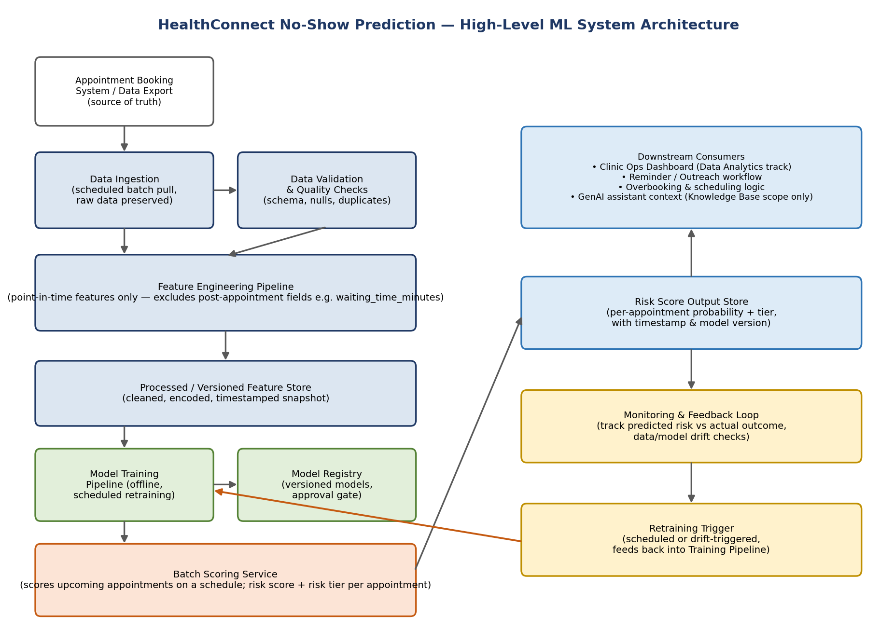

# HealthConnect Clinic — No-Show Prediction System
### AnalystLab Africa Experience Lab — Machine Learning Engineering Track

**Project:** Improving Patient Appointment Attendance and Healthcare Support Using Data and AI
**Author:** Raji Toluwanimi Samuel — Junior Machine Learning Engineer
**Status:** Week 4 (design), Week 5 (initial pipeline), Week 6 (integration & validation), Week 7 (testing, refinement & end-to-end validation), and Week 8 (final integration & cross-track validation) complete

## Project Overview

HealthConnect Clinic is a fictional healthcare provider facing missed appointments, inefficient use of appointment slots, and repetitive patient enquiries. The Experience Lab's central project question:

> **How can HealthConnect Clinic use data and AI to reduce missed appointments and improve the patient support experience?**

This repository documents the **Machine Learning Engineering track's** contribution: designing and building a reliable, reproducible, *tested* system that predicts appointment no-show risk and delivers that risk score to the people and systems that can act on it — while the **Data Science track** owns the modelling decisions, the **Data Analytics track** owns the reporting/KPIs, and the **Generative AI track** owns the patient-facing assistant.

This is a multi-track shared project. This repository covers the ML Engineering track's work only. **Cross-track collaboration:** four collaborations are now CLOSED, each with a received response and a documented, evidenced action taken — a Data Science handoff and response (feature testing, an investigated anomaly, and a confirmed final model), and three Project Management exchanges (a Week 7 input request, an independent Week 8 review, and a pointed Week 8 input questionnaire on the exact nature of the DS hand-off). All are in `docs/collaboration/`; see the "Cross-Track Collaboration" section below.

## Repository Structure

```
.
├── src/
│   ├── config.py                    # single source of truth: paths, column roles, target/risk-tier/governance definitions
│   ├── logging_config.py            # centralised logging setup (Week 6)
│   ├── data_ingestion.py            # load_raw_data() — schema-checked, never mutates the source file
│   ├── data_validation.py           # raw-data checks: missing values, duplicates, leakage, historical consistency
│   ├── feature_engineering.py       # point-in-time history, target build, imputation, encoding, engineered features
│   ├── validation_checks.py         # Week 6: preprocessing-to-model boundary checks
│   ├── error_analysis.py            # Week 6: TP/FP/TN/FN classification and feature profiling
│   ├── model.py                     # NoShowRiskModel wrapper + time_based_split()
│   ├── pipeline.py                  # orchestrates ingestion → validation → feature engineering → save
│   ├── train_baseline.py            # Week 5: trains the Logistic Regression baseline
│   ├── train_candidate_models.py    # Week 6: integrates + compares candidate models against the baseline
│   ├── score_appointments.py        # Week 6: batch scoring service + risk-tier assignment
│   ├── backtesting.py               # Week 7: expanding-window backtest (multi-period model stability)
│   ├── reminder_feature_analysis.py # Week 7: resolves the reminder-feature circularity question
│   ├── explainability.py            # Week 7: SHAP-based per-appointment explanations
│   └── run_week7_validation.py      # Week 7: orchestrates backtest + ablation + explanation evidence
├── tests/                           # 69 automated tests (pytest) covering every module in src/
├── notebooks/
│   ├── week5_pipeline_walkthrough.ipynb
│   ├── week6_integration_validation_walkthrough.ipynb
│   └── week7_testing_refinement_validation.ipynb
├── docs/
│   ├── ML_System_Design_Document.docx                  # Week 4
│   ├── Week4_Project_Summary.docx
│   ├── ML_Pipeline_Documentation.docx                  # Week 5
│   ├── Week5_Project_Summary.docx
│   ├── ML_Pipeline_Integration_Validation_Report.docx  # Week 6
│   ├── Week6_Project_Summary.docx
│   ├── ML_Pipeline_Testing_Reliability_Report.docx     # Week 7
│   ├── Week7_Project_Summary.docx
│   ├── PROJECT_RATIONALE.md                            # design-decision rationale, written as a learning resource
│   ├── HealthConnect_ML_Learning_Course.md             # learning series Part One (Weeks 4-6)
│   ├── HealthConnect_Week7_Learning_Course.md          # learning series Part Two (Week 7)
│   ├── HealthConnect_Week8_Learning_Course.md          # learning series Part Three (Week 8)
│   ├── collaboration/
│   │   ├── DataScience_Handoff_Package.docx             # sent to Data Science
│   │   ├── DataScience_Response_to_Handoff.docx         # received from Data Science
│   │   ├── ML_Engineering_Week7_PM_Input_Response.docx  # sent to Project Management (Week 7)
│   │   ├── ML_Engineering_Week7_PM_Review.docx          # received from Project Management (Week 8)
│   │   ├── ML_ENGINEERING_WEEK_8_PM_INPUT.docx          # received from Project Management (Week 8, 2nd exchange)
│   │   ├── ML_Engineering_Week8_PM_Input_Response.docx  # sent to Project Management (Week 8, 2nd exchange)
│   │   ├── ML_Pipeline_Final_Integration_Report.docx    # Week 8: response to both tracks, final readiness
│   │   └── HC_POD_Collaboration_Record.docx             # the 12-point record for all four collaborations, all closed
│   └── HealthConnect_Clinic_Knowledge_Base.docx         # reference resource
├── images/architecture/
│   └── healthconnect_ml_architecture.png
├── data/
│   ├── raw/                         # original CSV + data dictionary, untouched
│   ├── processed/                   # pipeline output: processed dataset + validation report
│   └── scored/                      # batch-scored appointments with risk tiers
├── models/                          # model artifacts, metrics, comparison/backtest/ablation reports
├── logs/                            # persistent pipeline run log
├── requirements.txt
├── test_results.txt                 # saved pytest output
├── .gitignore
└── README.md
```

> **Data handling note:** per the project's resource rules, original files in `data/raw/` are never modified. `data/processed/`, `data/scored/`, and `models/` hold this pipeline's own generated output, committed as reviewable evidence alongside the code that regenerates them.

## Week 4 — Project Kickoff & Problem Understanding

**ML System Design Document** — problem framing, input/output definition, architecture, workflow, dependencies.



## Week 5 — Pipeline Development & Initial Implementation

**ML Pipeline Documentation** — a working, tested pipeline (ingestion, validation, feature engineering, a swappable model wrapper, a baseline training script), 22 passing tests. Confirmed `waiting_time_minutes` leakage and chronologically inconsistent history columns; fixed both.

## Week 6 — Integration, Advanced Development & Validation

**ML Pipeline Integration & Validation Report** — integrated a Random Forest candidate through the unchanged model wrapper (Recall 0.621 → 0.654 on a single split), found and fixed two real integration bugs (a `bool`-dtype encoding issue; a Python truthiness crash on ensemble estimators), added preprocessing/model boundary validation, and implemented batch scoring. 46 tests passing.

## Week 7 — Testing, Refinement & End-to-End Validation

**ML Pipeline Testing & Reliability Report** — did not rebuild Week 6; tested it under conditions Week 6 hadn't covered.

### What changed this week

- **Multi-window backtest:** re-evaluated both models across 4 expanding, chronologically ordered time windows (not just one split). Random Forest's Recall advantage held in **every** fold (mean 0.638 vs 0.615) — the Week 6 model selection is now backed by genuine stability evidence, not a single favourable split.
- **Found and fixed a real reporting bug:** backtest date ranges were computed with string `.min()`/`.max()` on raw date text, which sorts lexicographically (`"10/1/2025"` before `"9/9/2025"`) rather than chronologically — fixed by parsing dates first, with a regression test added.
- **9 negative-scenario tests** — malformed files, schema drift at scoring time, missing values reaching the model boundary, and other invalid-input cases the pipeline must fail safely on, not just the "happy path" Weeks 5–6 mostly tested.
- **A true end-to-end integration test** — the full ingest → validate → engineer → split → train → score → tier flow, run as one connected system, plus a reproducibility check across two runs.
- **Resolved the reminder-feature circularity question** (open since Week 4): an ablation showed removing `reminder_sent`/`reminder_channel` costs 0.021 Recall; the features reflect the clinic's existing, model-independent reminder process and are not leakage for the current dataset — kept, with a documented governance condition for if the reminder process itself ever becomes model-driven.
- **SHAP-based individual explanations**, tested against the real saved candidate model on real scored appointments — turning a bare risk tier into a specific, readable "why" for a clinic worker.

### Backtest result (4 expanding time windows)

| Model | Mean Recall | Std | Min | Max |
|---|---|---|---|---|
| **Random Forest (selected)** | **0.638** | 0.022 | 0.606 | 0.664 |
| Logistic Regression (baseline) | 0.615 | 0.021 | 0.595 | 0.650 |

### Test suite growth

| Week | Tests passing |
|---|---|
| Week 5 | 22 |
| Week 6 | 46 |
| **Week 7** | **69** |

## How to Reproduce

```bash
pip install -r requirements.txt

# Run the full data pipeline
python -m src.pipeline

# Train and evaluate the Week 5 baseline
python -m src.train_baseline

# Train, compare, and integrate Week 6 candidate models
python -m src.train_candidate_models

# Score a batch of appointments with the selected candidate
python -m src.score_appointments

# Run all Week 7 validation (backtest + reminder ablation + SHAP examples)
python -m src.run_week7_validation

# Run the automated test suite (69 tests)
python -m pytest tests/ -v

# Explore the walkthrough notebooks
jupyter notebook notebooks/
```

## Week 8 — Final Integration, Presentation & Project Showcase

**ML Pipeline Final Integration & Engineering Package** (`docs/collaboration/ML_Pipeline_Final_Integration_Report.docx`) — closed out both cross-track collaborations with real, evidenced answers rather than assumptions.

### What Data Science confirmed or changed

| Question | Outcome |
|---|---|
| Cancelled-appointment handling | Confirmed: excluded by default |
| Reminder-feature governance | Confirmed keep; reframed as a symptom-vs-cause question, documentation updated |
| Fold-3 backtest weakness | **Investigated and closed** — statistically explained as ordinary sampling noise (expected SE ≈0.025 vs observed 0.022), not a systematic effect |
| Two new feature proposals | **Implemented and empirically tested** (4-window A/B backtest) — neither improved Recall or ROC-AUC; both excluded by default, kept in code and toggleable |
| Final model | **Confirmed: Random Forest**, unconditionally |

### What Project Management's independent review caught

A formal review distinguished technical pipeline testing from full solution readiness — correctly identifying that the main blocker to operational deployment is business/clinic input on risk thresholds, not further engineering. All 8 carry-forward items were addressed: 4 closed with evidence, 1 reframed, 3 correctly left open as genuine cross-track dependencies rather than force-closed.

### Test suite growth

| Week | Tests passing |
|---|---|
| Week 6 | 46 |
| Week 7 | 69 |
| **Week 8** | **74** |

## Cross-Track Collaboration

Four cross-track collaborations are CLOSED, per the brief's mandatory HC-POD requirement — each with a real response received and a documented, evidenced action taken:

**1. Data Science track — handoff sent, full response received and actioned.** Five questions asked (Section above); all five answered, and every answer acted on in code, tests, or documentation.
- `docs/collaboration/DataScience_Handoff_Package.docx` (sent) → `docs/collaboration/DataScience_Response_to_Handoff.docx` (received) → `docs/collaboration/ML_Pipeline_Final_Integration_Report.docx` (actioned)

**2. Project Management track — Week 7 input request, completed.** A structured 8-section questionnaire, answered in full with quantified evidence.
- `docs/collaboration/ML_Engineering_Week7_PM_Input_Response.docx`

**3. Project Management track — Week 8 independent review, completed.** A 12-area readiness review with 8 carry-forward items, each addressed with current status.
- `docs/collaboration/ML_Engineering_Week7_PM_Review.docx` (received) → `docs/collaboration/ML_Pipeline_Final_Integration_Report.docx`, Section 4 (response)

**4. Project Management track — Week 8 input questionnaire, completed.** A pointed 8-question exchange specifically probing whether an actual Data Science-trained model had been received and executed. Answered with full precision: no separate DS-trained artifact was ever received — Data Science confirmed ML Engineering's own Random Forest stand-in as final, rather than supplying a new one — stated plainly rather than left ambiguous ahead of the final presentation.
- `docs/collaboration/ML_ENGINEERING_WEEK_8_PM_INPUT.docx` (received) → `docs/collaboration/ML_Engineering_Week8_PM_Input_Response.docx` (response)

**The full 12-point record for all four** is in `docs/collaboration/HC_POD_Collaboration_Record.docx` — every field is filled with a real outcome; none are placeholders.

## Cross-Track Dependencies

- **Data Science track** — target variable treatment, feature selection, and model choice, now confirmed for the final model (see Week 8 section above).
- **Data Analytics track** — the specific fields/format needed from the scored output for dashboard consumption; not yet confirmed by that track.
- **Generative AI track** — any assistant use of appointment risk data must stay within the approved Knowledge Base scope.
- **Project Management track** — coordinating the remaining business-input dependency (risk-tier thresholds) with clinic stakeholders.

## Remaining Work

1. **Finalise risk-tier thresholds with real clinic operational input** (currently provisional) — the primary remaining blocker to full operational readiness, requiring business/clinic input via Project Management coordination.
2. **Confirm the scored-output fields/format needed by the Data Analytics track** for dashboard consumption.
3. ~~Investigate the fold-3 (Jan–Apr 2026) weak period identified in backtesting~~ — **DONE**, resolved by Data Science as ordinary sampling noise, not a systematic effect.

## Related Work

This intern's Weeks 1–3 work (Customer Churn Prediction — Machine Learning Internship track) is a separate, prior project and is not part of this repository.

## License

MIT — see `LICENSE`.

---
*Part of the AnalystLab Africa Experience Lab.* #AnalystLabAfrica
